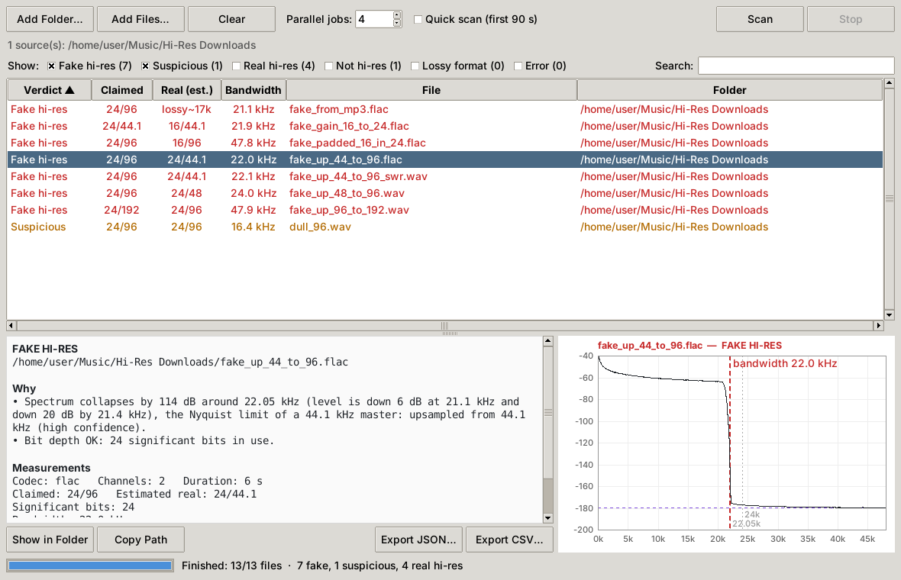
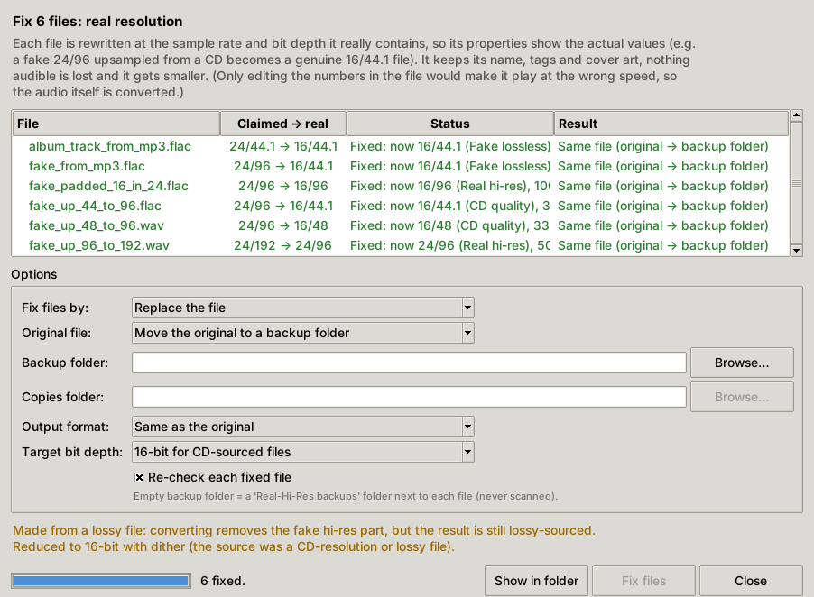
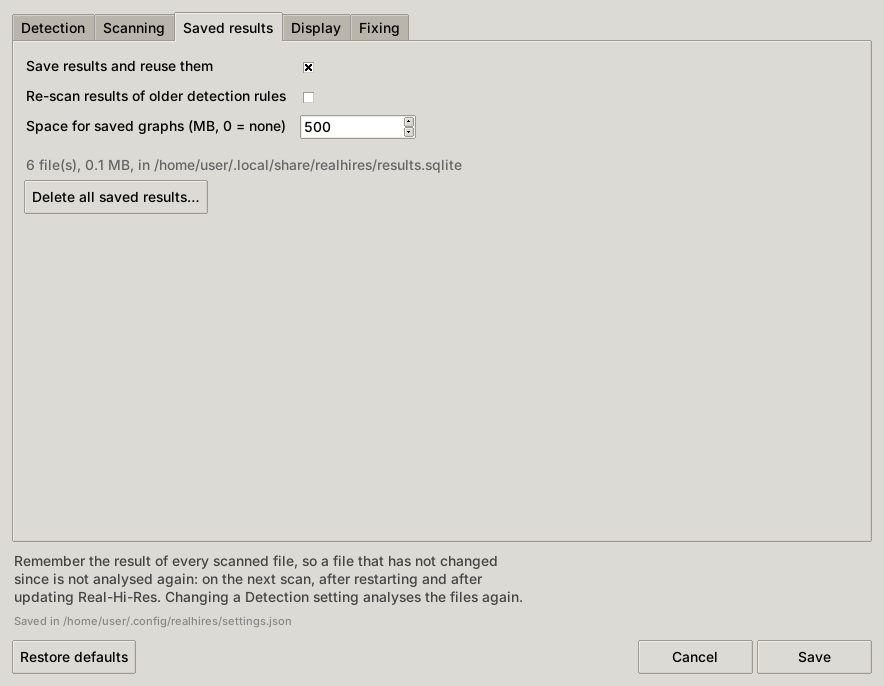

# Real-Hi-Res

Real-Hi-Res is a desktop app and command-line tool that scans your music library and tells you which files are genuine and which ones are fakes. It finds two kinds of fake. The first is **fake hi-res**: files whose container advertises something like 24-bit/96 kHz or 24-bit/192 kHz while the audio inside came from a CD-quality or 48 kHz master, or from a 16-bit master padded with zeros. The second is **fake lossless**, often called a "fake FLAC": FLAC, ALAC, WAV, AIFF or similar files, at any resolution, that were made by converting an MP3 or AAC file and therefore are not really lossless. The tool does not trust tags or file headers. It decodes the audio and checks the sample data itself against what the claimed format should contain.



## Download and run (no installation needed)

Ready-to-run packages are attached to every release on the [Releases page](https://github.com/SU2H1/Real-Hi-Res/releases/latest). Python, NumPy and FFmpeg are bundled inside, so you only download, unpack and start it.

| System | Download | Start the app | Command line |
| --- | --- | --- | --- |
| Windows 10/11, 64-bit | `RealHiRes-windows-x64.zip` | `RealHiRes\RealHiRes.exe` | `RealHiRes\realhires-cli.exe "D:\Music"` |
| macOS 12 Monterey or later, Apple Silicon (M1 and later) | `RealHiRes-macos-arm64.dmg` (or `.zip`) | `RealHiRes.app` | `/Applications/RealHiRes.app/Contents/MacOS/realhires-cli ~/Music` |
| macOS 10.15 Catalina or later, Intel | `RealHiRes-macos-x86_64.dmg` (or `.zip`) | `RealHiRes.app` | `/Applications/RealHiRes.app/Contents/MacOS/realhires-cli ~/Music` |
| Linux, x86-64 (PC) | `RealHiRes-linux-x64.tar.gz` | `RealHiRes/RealHiRes` | `RealHiRes/realhires-cli ~/Music` |
| Linux, ARM64 (Raspberry Pi 4/5 with 64-bit OS, ARM laptops and servers) | `RealHiRes-linux-arm64.tar.gz` | `RealHiRes/RealHiRes` | `RealHiRes/realhires-cli ~/Music` |

If you are not sure which Mac you have, open the Apple menu and choose **About This Mac**. "Chip: Apple M…" means Apple Silicon, and "Processor: Intel…" means Intel. On Linux, `uname -m` prints `x86_64` for the x64 package or `aarch64` for the ARM64 package.

### macOS

Open the `.dmg` and drag **RealHiRes** into **Applications**. The app is not signed with an Apple Developer ID, so the first launch is blocked with a message that the app "is damaged" or "cannot be opened". On macOS 15 Sequoia and later, open **System Settings → Privacy & Security**, scroll down, and click **Open Anyway** next to the RealHiRes message. On older versions, right-click the app and choose **Open**. Alternatively, this Terminal command works on every version:

```bash
xattr -dr com.apple.quarantine /Applications/RealHiRes.app
```

### Linux

The Linux packages are built on glibc 2.28. They therefore run on practically every distribution from 2018 onwards, including Ubuntu 18.10+, Debian 10+, Linux Mint 20+, Fedora 29+, RHEL/Rocky/AlmaLinux 8+, openSUSE Leap 15.3+, Arch and Manjaro. The app needs a graphical desktop (X11, or Wayland with XWayland, which every mainstream desktop provides). The command-line tool runs anywhere, including on servers. Unpack the archive wherever you like to keep the app:

```bash
tar -xzf RealHiRes-linux-x64.tar.gz
```

Then optionally add Real-Hi-Res to your application menu and put `realhires-cli` on your `PATH` (in `~/.local/bin`). This installs for your user only and needs no root:

```bash
RealHiRes/install.sh
```

The app keeps running from the unpacked folder, so run `install.sh` again if you move the folder, and run `RealHiRes/uninstall.sh` to remove the menu entry.

### Windows

Unzip the archive and double-click `RealHiRes.exe`. The app is not code-signed, so SmartScreen may show "Windows protected your PC" the first time. Continue with **More info → Run anyway**.

## Desktop app (GUI)

Click **Add Folder…** (or **Add Files…**). Each folder or file you add appears straight away in the **Sources to scan** panel with the number of audio files found in it. A folder without audio files is shown in red ("no audio files found"), so you know immediately whether it was added correctly. All files that were found are listed below as **Not scanned**, and you can select one and open its folder before scanning. Adding the same folder twice is ignored, and **Remove** (or the Delete key) takes a selected source out again.


Large folders are listed progressively while they are being searched ("1500 so far…"), so you see files appear immediately instead of waiting.

Press **Scan** when the list looks right. Everything updates live while the scan runs. The files being worked on right now are marked **Analysing…** in blue, and every finished file shows its verdict and reason in place straight away. The progress bar and status line count along ("Scanning (8 at a time): 120/500 files"), and the Sources panel shows the number of fake or suspicious files per source. If the selected file finishes, the dashboard updates with it. All rows stay visible during the scan, and the verdict filters are applied once it has finished.


By default one file per CPU core is analysed at a time (**Parallel jobs = 0**, automatic). You can set up to 512 in Settings → Scanning, although more jobs than CPU cores does not make scanning faster. After the scan the list shows only the problem files by default (**Fake lossless**, **Fake hi-res** and **Suspicious**), so you can scroll straight through them. Each row has a short **Why** column that says in one line what is wrong, for example "Upsampled from 44.1 kHz: nothing above 22.05 kHz" or "Made from a lossy file (MP3/AAC-style cut-off at 16.0 kHz)". Tick the other boxes (Real hi-res, CD quality, Lossy format, Error) to see everything, and use the search box to filter by file name, folder or reason. Each checkbox shows how many files have that verdict, and clicking a column header sorts by it.

**Summary after each scan.** When a scan finishes, a summary window shows a **pie (donut) chart** of the verdicts. Each slice is labelled with its percentage, and the centre shows the share of fake or suspicious files. Next to the chart, a legend lists every verdict with its percentage, the number of files and a short explanation. **Clicking a slice or a legend entry lists only those files.** The buttons jump to all problem files or all files, or export a CSV report. You can reopen the window at any time with **View → Scan summary…**, and you can switch it off in Settings or with the checkbox in the window itself.


**Dashboard.** Clicking a file fills the dashboard below the list with the following:

- The verdict as a coloured badge, together with the concise reason.
- The key facts: the claimed resolution, the resolution the audio really has, the bandwidth, how many bits are actually used, the format and the duration.
- A **spectrogram** (time left to right, frequency bottom to top). On an upsampled or MP3-sourced file it shows a hard black area above the cut-off for the whole track, and the detected cut-off is marked with a labelled line.
- The **average spectrum** tab, which shows the same thing as a single curve.
- The full reasoning and measurements under **Details**.

**Opening files quickly.** **Open Folder** opens the file's folder in Explorer, Finder or your Linux file manager with the file selected, and **Open File** plays it in your default player. Double-clicking a row or pressing **Enter** opens the folder, and **Ctrl+Enter** (**Cmd+Enter** on a Mac) opens the file. You can swap these two in Settings. Right-click a row for the same actions, or **Ctrl+C** to copy the paths of the selected rows. **File → Export…** saves the listed files as CSV or JSON.

**Fix to real resolution.** Select one or more fake files and click **Fix to real resolution…** (or press **Ctrl+F**, use the right-click menu, or choose **Edit → Fix all fake files to real resolution…**). The file itself is corrected: it keeps its name, its folder, its tags (including non-Latin text) and its cover art, and afterwards its properties show the resolution it really has. In Explorer, Finder, your music player or Real-Hi-Res, a fake 24-bit/96 kHz file upsampled from a CD then shows 16-bit/44.1 kHz. A 16-bit file padded to 24 bits shows 16-bit, and a fake 24/192 file made from a 96 kHz master shows 24/96. Nothing audible is lost, and the files usually get much smaller.

The sample rate and bit depth in a file's properties come from its audio stream. Only changing those numbers, without touching the audio, would make the file play at the wrong speed or as noise. Real-Hi-Res therefore rewrites the audio at the real resolution with the SoX resampler. It adds triangular dither only when a resampled signal is reduced to 16 bits, so padded audio is converted bit-exactly. It writes to a temporary file first, so an interrupted fix never leaves a broken file.

The dialog shows "claimed → real" for every file before you start, then each file's new verdict after re-checking it (for example "Fixed: now 16/44.1 (CD quality)"). The list updates to match. Its options are:

- **Original file** says what happens to the original. By default it is moved to a **Real-Hi-Res backups** folder inside the file's folder (or into a backup folder you choose), from where you can restore it at any time. The backup folder is never scanned. You can also keep it as `<name>.bak` next to the file, or delete it (no backup, asked for confirmation).
- **Fix files by** chooses between replacing the file (the default) and leaving it alone while saving a corrected copy next to it (`Song [16-44.1].flac`) or into a folder.
- **Target bit depth** defaults to "16-bit for CD-sourced files". Resampling a 16-bit CD master to 96 kHz fills the low bits, so such files measure as 24-bit, and this option restores 16-bit where the source was a CD or a lossy file. The other choices are "As detected" and "Always 16-bit".
- **Output format** keeps the same format as the original (FLAC, WAV, AIFF, ALAC, WavPack; other formats become FLAC), or always writes FLAC.

Files made from an MP3/AAC can be fixed too, but this only removes their fake hi-res part, because they remain lossy-sourced and stay marked as fake lossless.



**Settings.** **⚙ Settings…** (or **Ctrl+,**) opens a window with four tabs, and pointing at any setting shows an explanation of what it does:

- **Detection** holds every detection threshold described under [How detection works](#how-detection-works): the upsampling cliff, the lossy cut-off drop and search range, the expected ultrasonic content, the bit-usage threshold and more.
- **Scanning** covers parallel jobs, analysing only the first N seconds, the quick-scan length, sub-folders and file extensions.
- **Display** sets which verdicts are listed by default, the summary pop-up, what double-click does, and the spectrogram colours and range.
- **Fixing** holds the defaults of the Fix dialog: replace or copy, what happens to the original, the backup and copy folders, the output format, the target bit depth, the copy suffix and the re-check.

Settings are saved and used again the next time you start the app, and by the command-line tool too. **Restore defaults** undoes all changes. Detection changes apply to the next scan.



## Running from source

You need Python 3.9 or newer, NumPy, and FFmpeg (both `ffmpeg` and `ffprobe` must be on your `PATH`). FFmpeg does the decoding, so every format it understands works: FLAC, WAV, AIFF, ALAC/M4A, APE, WavPack, DSF/DFF (DSD), TTA, MKA, and lossy formats such as MP3, AAC, Opus and Vorbis. The GUI also needs Tkinter, which is included with the python.org installers for Windows and macOS. On Linux, install it with `sudo apt install python3-tk` (Debian/Ubuntu) or `sudo dnf install python3-tkinter` (Fedora).

On macOS you can install FFmpeg with `brew install ffmpeg`. On Ubuntu or Debian use `sudo apt install ffmpeg`, and on Windows use `winget install ffmpeg`.

Clone the repository and install it with pip, which gives you the `realhires` command and the `realhires-gui` desktop app:

```bash
git clone https://github.com/SU2H1/Real-Hi-Res.git
```

```bash
cd Real-Hi-Res && pip install .
```

You can also run it without installing by calling `python -m realhires` (command line) or `python -m realhires.gui` (desktop app) from inside the repository folder.

## Command-line usage

Point the tool at one or more files or folders. Folders are scanned recursively. (In a release package the command is called `realhires-cli` instead of `realhires`.)

```bash
realhires ~/Music/HiRes
```

The output is one line per file. Fake and suspicious files get a one-line reason underneath, marked with `→`, and `-v` adds the full reasoning. At the end, the percentage of files per verdict is printed:

```
VERDICT        CLAIMED    REAL(EST)   BANDWIDTH  FILE
FAKE LOSSLESS  16/44.1    lossy~17k   17.4k      album_track_from_mp3.flac
               → Made from a lossy file (MP3/AAC-style cut-off at 17.0 kHz)
FAKE HI-RES    24/96      24/44.1     22.0k      fake_up_44_to_96.flac
               → Upsampled from 44.1 kHz: nothing above 22.05 kHz
FAKE HI-RES    24/96      16/96       47.8k      fake_padded_16_in_24.flac
               → Padded: only 16 of 24 bits used
FAKE HI-RES    24/192     24/96       47.9k      fake_up_96_to_192.wav
               → Upsampled from 96 kHz: nothing above 48 kHz
REAL HI-RES    24/96      24/96       47.8k      real_24_96.flac
REAL HI-RES    24/192     24/192      95.5k      real_24_192.wav
NOT HI-RES     16/44.1    16/44.1     21.9k      cd_16_44.wav
LOSSY FORMAT   mp3/44.1   -           17.4k      src.mp3

Scanned 8 file(s): 1 fake lossless (12.5%), 3 fake hi-res (37.5%), 2 real hi-res (25.0%), 1 not hi-res (12.5%), 1 lossy format (12.5%)
  FAKE LOSSLESS   12.5%      1  ████
  FAKE HI-RES     37.5%      3  ███████████
  REAL HI-RES     25.0%      2  ████████
  NOT HI-RES      12.5%      1  ████
  LOSSY FORMAT    12.5%      1  ████
```

`CLAIMED` is the resolution the file advertises (bits/kHz, with `f` marking floating point). `REAL(EST)` is the resolution the audio actually carries according to the analysis, or `lossy~17k` when the source was a lossy file cut off at about 17 kHz. `BANDWIDTH` is the highest frequency at which the file contains real content.

### Options

| Option | Meaning |
| --- | --- |
| `-v`, `--verbose` | Show the full reasoning and raw measurements for every file, not just the one-line reasons of the problem files. |
| `--only VERDICT` | List only some files. You can repeat it. `fake` means fake hi-res and fake lossless, `problems` means fake plus suspicious, and the other choices are `fake-hires`, `fake-lossless`, `suspicious`, `real`, `not-hires`, `lossy` and `error`. |
| `--json FILE` | Write every measurement, including the one-line `summary` and the `flags`, to a JSON file. |
| `--csv FILE` | Write a CSV summary, which is handy for spreadsheets. |
| `--spectrogram DIR` | Write a PNG spectrogram for each file, with the detected cut-off marked. |
| `--plot DIR` | Write an SVG average-spectrum plot for each file. |
| `-j N`, `--jobs N` | Analyse N files in parallel (1–512). `0` means one per CPU core, which is the default. |
| `--fix` | After scanning, fix every fake file in place so that its properties show its real resolution (same name, tags and cover art). Originals are moved to a `Real-Hi-Res backups` folder next to them. See "Fix to real resolution" above. |
| `--fix-backup folder\|bak\|none` | With `--fix`, keep originals in the backup folder (default), as `<name>.bak`, or delete them. |
| `--fix-backup-dir DIR` | With `--fix`, move the originals into `DIR`. |
| `--fix-copy` / `--fix-dir DIR` | With `--fix`, leave the files alone and save corrected copies next to them or into `DIR`. |
| `--dry-run` | With `--fix`, only show what would be changed. |
| `-t SECONDS`, `--max-seconds SECONDS` | Analyse only the first N seconds of each file, which is faster but slightly less reliable. |
| `-n`, `--no-recursive` | Do not descend into sub-folders. |
| `--set NAME=VALUE` | Override one setting for this run, for example `--set cliff_db=30` or `--set lossy_max_khz=20.8`. You can repeat it. |
| `--list-settings` | Print every setting with its current value and description. |
| `--settings FILE` / `--no-settings` | Use a different settings file, or ignore the saved settings and use the defaults. |
| `--no-color` | Disable coloured output. Setting the `NO_COLOR` environment variable does the same. |

For example, the following commands first show what would be fixed and then fix all fake files in a library in place, with the originals kept in backup folders:

```bash
realhires ~/Music --fix --dry-run
```

```bash
realhires ~/Music --fix
```

And the following command lists only the problem files and saves spectrograms and a CSV report:

```bash
realhires ~/Music --only problems --spectrogram realhires-report/spectrograms --csv realhires-report/report.csv
```

### Settings file

The desktop app and the command-line tool share one settings file. It lives at `%APPDATA%\RealHiRes\settings.json` on Windows, `~/Library/Application Support/RealHiRes/settings.json` on macOS, and `~/.config/realhires/settings.json` on Linux. You can point to another file with the `REALHIRES_SETTINGS` environment variable. It is plain JSON and is easiest to edit in the app's Settings window. Invalid or unknown values are ignored and fall back to their defaults, so a broken file never stops the program. `realhires --list-settings` shows every setting.

## Verdicts

| Verdict | In the app | Meaning |
| --- | --- | --- |
| **FAKE LOSSLESS** | Fake lossless | A "fake FLAC": a lossless file (FLAC, ALAC, WAV, AIFF, APE, WavPack…) at any resolution that was made from an MP3, AAC or other lossy file. Its spectrum has an encoder's brick-wall low-pass between 11 and 20.3 kHz. |
| **FAKE HI-RES** | Fake hi-res | The file claims hi-res but was upsampled from a lower sample rate, or it is 16-bit audio padded into a 24-bit or float container. The reason says which. |
| **SUSPICIOUS** | Suspicious | The file claims a high sample rate but has no content above about 24.5 kHz and no brick-wall edge. This can be an old or dull recording, a gentle-filter upsample, or a 20-bit master in a 24-bit file. Check the spectrogram to decide. |
| **REAL HI-RES** | Real hi-res | The file claims hi-res and passed both the spectral test and the bit-depth test. |
| **NOT HI-RES** | CD quality | Genuine lossless audio at CD resolution (16-bit at 44.1 or 48 kHz). It does not claim to be hi-res, and no lossy source was found. |
| **LOSSY FORMAT** | Lossy format | The file itself is MP3, AAC, Opus, Vorbis or a similar format, which is lossy by design. |
| **ERROR** | Error | The file could not be decoded. |

## How detection works

The tool runs two independent tests on the decoded samples. A file is judged real only when both pass.

### 1. Spectral test (sample rate)

Every digital master has a hard upper frequency limit at half its sample rate, called the Nyquist frequency. That limit is 22.05 kHz for 44.1 kHz, 24 kHz for 48 kHz, and 48 kHz for 96 kHz. Before audio is stored at a given rate it passes through a very steep anti-aliasing filter just below that limit. When someone later upsamples a 44.1 kHz master to 96 kHz, no new information is created, so the spectrum still falls off a cliff at about 22 kHz and contains nothing but the noise of the resampler above it. A real 96 kHz recording instead continues smoothly past 22 kHz, with cymbal and string harmonics, room tone and microphone noise, until it reaches its own limit near 48 kHz.

The tool averages the power spectrum of the whole track with an FFT of roughly 6 Hz resolution, using a Blackman-Harris window that has enough dynamic range to see a 24-bit noise floor. It then performs three measurements on that spectrum.

The first is the **cliff test**. For every common lower source rate (44.1, 48, 88.2, 96, 176.4 and 192 kHz) that is clearly below the file's rate, the tool compares the level just below that rate's Nyquist frequency (88–96 %) with the level just above it (102–112 %). A drop of 25 dB or more marks the file as upsampled from that rate. A drop of 40 dB or more gives high confidence. Real music changes by only a few dB across that boundary. When neighbouring rates such as 44.1 and 48 kHz both show a large drop, which happens when a resampler's transition band straddles both, the tool finds the frequency where the level has actually fallen by 20 dB. It then picks the rate whose Nyquist frequency fits that point best, since resamplers place it at about 0.97–1.02 times the source Nyquist. Because this test looks at a narrow window around each candidate edge, it still works when noise-shaped dither (for example in a fake DSD file) fills the top of the spectrum.

The second is the **lossy cliff scan**, which finds fake lossless files ("fake FLACs"). MP3, AAC and Vorbis encoders throw away everything above about 16–20 kHz with an extremely steep low-pass: about 16 kHz for 128 kbps MP3, 19–20 kHz for 192–320 kbps. Converting such a file to FLAC or WAV keeps that hole. The tool searches the range from 11 to 20.3 kHz for a drop of 25 dB or more within about one kilohertz that never recovers at higher frequencies. This works at any sample rate, so it catches a 16/44.1 FLAC made from an MP3 just like a "24/96" one. A genuine CD master normally extends to 20–22 kHz.

The third is the **effective bandwidth** measurement, which is the highest frequency where a continuous band of at least 300 Hz sits clearly above the noise floor. The floor reference is the top of the spectrum, capped near the theoretical quantisation noise of the file's bit depth so that content reaching Nyquist still counts. Content more than 110 dB below the spectral peak is ignored. If a high-sample-rate file has no content above about 24.5 kHz but also no brick-wall edge, it is reported as suspicious rather than fake.

### 2. Bit-depth test

FFmpeg decodes every integer format into left-justified 32-bit samples, so a 24-bit sample keeps its 8 unused bits at zero and a 16-bit sample keeps 16 zero bits. For every non-zero sample the tool records the lowest bit that is set. In real 24-bit audio the 24th bit is set in about half of all samples, because the lowest bits carry noise and fine detail. If a 16-bit master was simply padded to 24 bits, nothing below bit 16 is ever set, and the file is reported as "16 of 24 bits used". A threshold of 0.5 % of samples means that a handful of clipped or odd samples cannot hide the padding. The same test catches 16-bit audio stored as 32-bit float, because every sample is then an exact 16-bit value.

## Why was the number of parallel jobs limited to 61?

That limit comes from Python on Windows, not from Real-Hi-Res. Python's process pool waits for its worker processes with the Windows function `WaitForMultipleObjects`, which can watch at most 64 handles, and Python keeps 3 of those for itself, so one pool can have at most 61 workers. Since version 1.4.0, Real-Hi-Res splits larger job counts over several pools (for example 64 jobs run as 2 × 32), so all cores of a big workstation can be used, up to 512 jobs. On macOS and Linux there was never such a limit. For the fastest scans, leave **Parallel jobs** at 0 (automatic), which uses one job per CPU core. More jobs than cores only makes the files compete for the same processors.

## Limitations

No automatic tool can be certain, so please read the reasons and look at the plots for files that matter to you. The following cases are known to be hard.

A source sample rate guess can be off by one family member. A resampler with a very soft transition (such as FFmpeg's default `swr` settings) smears the 22.05 kHz edge up past 23 kHz, so a 44.1 kHz source can be reported as 48 kHz. The verdict is still FAKE, but the source rate is approximate.

A 16-bit master that was converted to 24-bit with a gain change, dither or resampling fills the low bits with values, so the bit-depth test passes. If the sample rate was also raised, the spectral test still catches it. Plain "16/44.1 to 24/44.1 with a volume change" is not detected.

Old analogue recordings often have no content above 20 kHz even when transferred at 96 kHz or higher. These appear as SUSPICIOUS rather than REAL or FAKE, because the data cannot prove which one they are.

A real hi-res file whose ultrasonic band contains only analogue tape or microphone hiss is reported as REAL, because that hiss is genuinely captured above 22 kHz.

MP3 files encoded at 320 kbps low-pass at about 20.5 kHz, which overlaps with ordinary CD anti-aliasing filters, so a lossy source is not always detectable in a 44.1 or 48 kHz file. Upsampled to hi-res, such a file is still caught by the cliff test. You can raise **Lossy cut-off search up to** in Settings (`lossy_max_khz`) to about 20.8 kHz to catch more of them, at the risk of flagging CD masters that have an unusually low and steep anti-aliasing filter.

## Development

Run the test suite with pytest. The tests generate synthetic real and fake files (genuine 24/96 and 24/192, upsampled 44.1→96, 48→96, 96→192, bit-padded 16-in-24, 16-in-float, MP3-sourced, dull and silent files) with FFmpeg, so no audio files are stored in the repository.

```bash
python3 -m pytest -q
```

### Building the packages and publishing a release

The release packages are built by GitHub Actions ([`.github/workflows/build.yml`](.github/workflows/build.yml)) in six jobs: Windows x64, macOS Apple Silicon, macOS Intel, Linux x64 and Linux ARM64. The Linux jobs run inside an AlmaLinux 8 container so that the packages only need glibc 2.28. Every job runs [`packaging/ci_build.sh`](packaging/ci_build.sh), which goes through the following steps in order:

1. It downloads a static FFmpeg.
2. It runs the test suite with that FFmpeg.
3. It builds the package with PyInstaller.
4. It runs [`packaging/check_compat.py`](packaging/check_compat.py), which fails the build if any bundled file needs a newer glibc or macOS than the package claims, or (on macOS) lacks the right CPU architecture.
5. It smoke-tests the frozen command-line tool with an empty `PATH`.
6. It packages the result.

Every push uploads the packages as workflow artifacts. A GitHub Release is published automatically in two cases. The first is when `main` receives a commit whose version (`__version__` in `realhires/__init__.py`, kept equal to `version` in `pyproject.toml`) has not been released yet, so bumping the version and merging into `main` releases it. The second is when a tag matching that version is pushed:

```bash
git tag v1.1.0
```

```bash
git push origin v1.1.0
```

To build a package on your own machine, install the build tools and run the same script with the name of the archive you want. The result appears in `out/`.

```bash
pip install numpy pyinstaller pillow pytest
```

```bash
ASSET=RealHiRes-local bash packaging/ci_build.sh
```

On Linux, run it inside AlmaLinux 8 for the widest compatibility (`bash packaging/linux/setup_almalinux8.sh` prepares such a container, after which you set `PYTHON=/opt/venv/bin/python`). A build made directly on a newer distribution only runs on that distribution's glibc or newer, and `check_compat.py` will say so.

The project layout is documented in [CLAUDE.md](CLAUDE.md).

## License

No license has been chosen yet.
