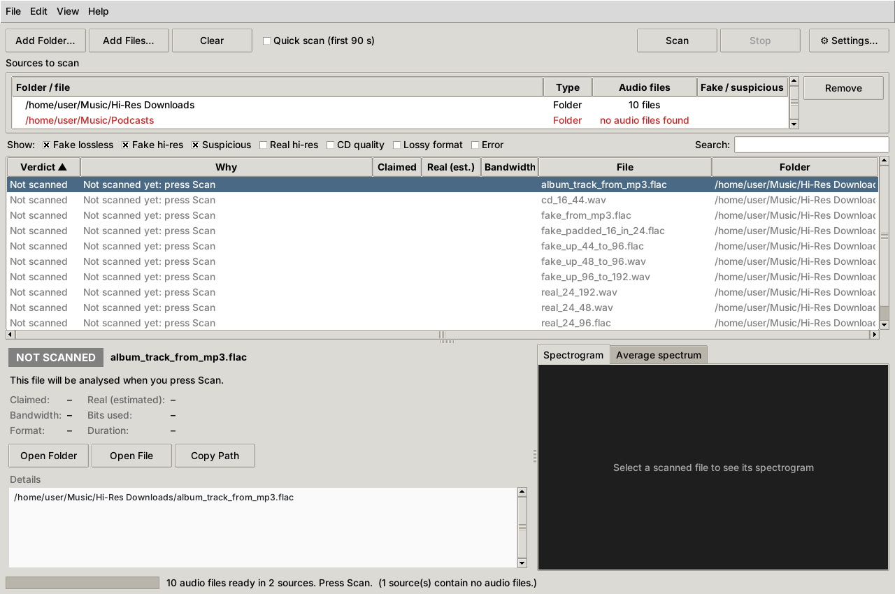
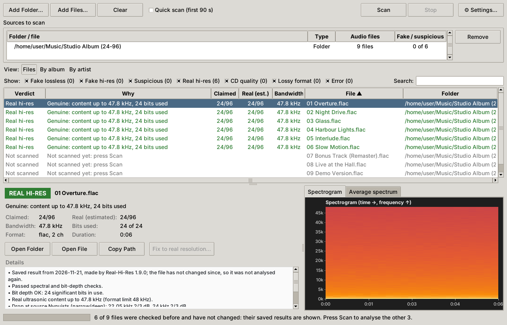
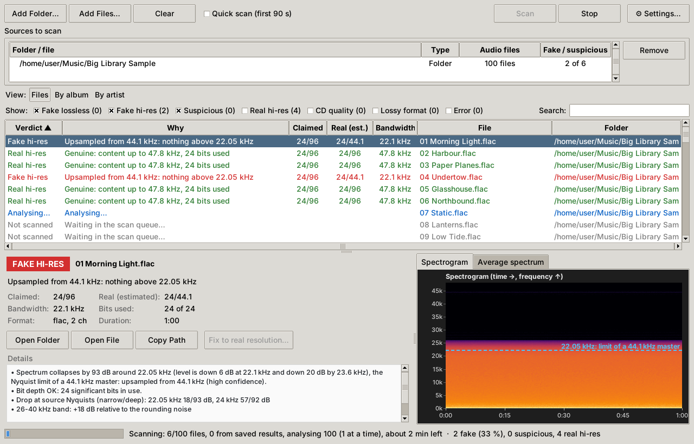
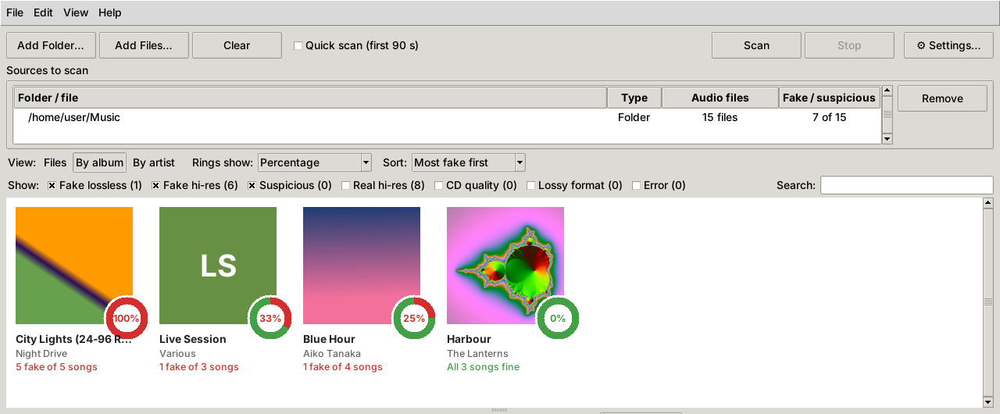
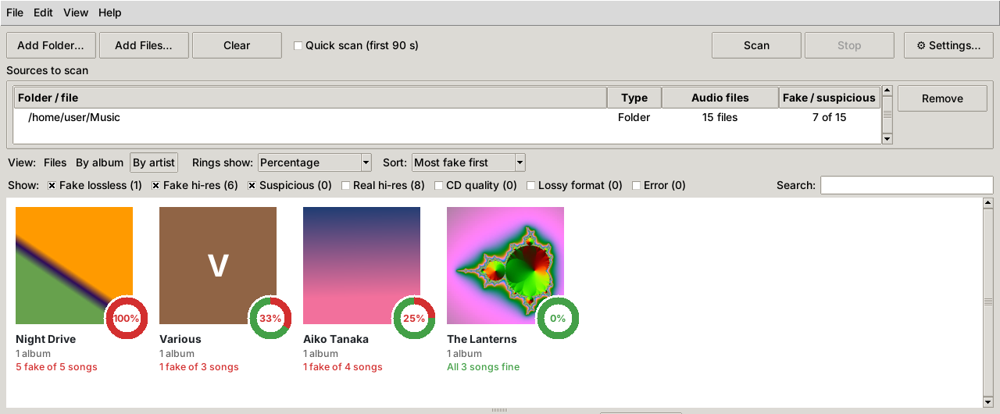
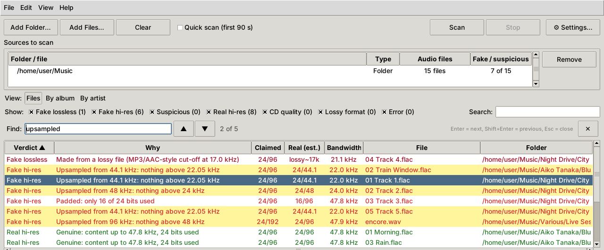
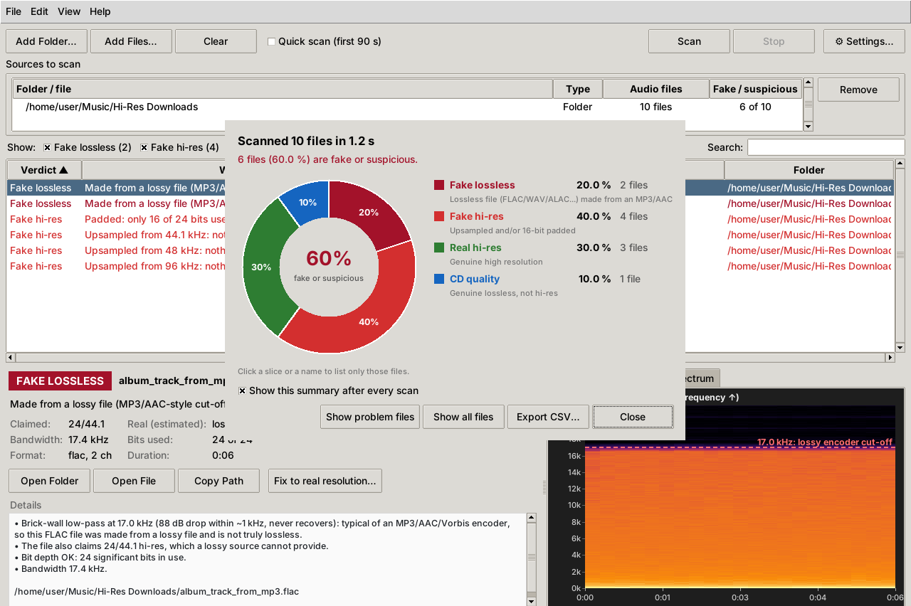

# Real-Hi-Res

Real-Hi-Res is a desktop app and command-line tool that scans your music library and tells you which files are genuine and which ones are fakes. It finds two kinds of fake. The first is **fake hi-res**: files whose container advertises something like 24-bit/96 kHz or 24-bit/192 kHz while the audio inside came from a CD-quality or 48 kHz master, or from a 16-bit master padded with zeros. The second is **fake lossless**, often called a "fake FLAC": FLAC, ALAC, WAV, AIFF or similar files, at any resolution, that were made by converting an MP3 or AAC file and therefore are not really lossless. The tool does not trust tags or file headers. It decodes the audio and checks the sample data itself against what the claimed format should contain.


## Download and run (no installation needed)

Ready-to-run packages are attached to every release on the [Releases page](https://github.com/SU2H1/Real-Hi-Res/releases/latest). Python, NumPy and FFmpeg are bundled inside, so you only download, unpack and start it. Every file name carries the version, for example `RealHiRes-1.10.0-windows-x64.zip`; `<version>` in the table below stands for it.

| System | Download | Start the app | Command line |
| --- | --- | --- | --- |
| Windows 10/11, 64-bit | `RealHiRes-<version>-windows-x64.zip` | `RealHiRes\RealHiRes.exe` | `RealHiRes\realhires-cli.exe "D:\Music"` |
| macOS 12 Monterey or later, Apple Silicon (M1 and later) | `RealHiRes-<version>-macos-arm64.dmg` (or `.zip`) | `RealHiRes.app` | `/Applications/RealHiRes.app/Contents/MacOS/realhires-cli ~/Music` |
| macOS 10.15 Catalina or later, Intel | `RealHiRes-<version>-macos-x86_64.dmg` (or `.zip`) | `RealHiRes.app` | `/Applications/RealHiRes.app/Contents/MacOS/realhires-cli ~/Music` |
| Linux, x86-64 (PC) | `RealHiRes-<version>-linux-x64.tar.gz` | `RealHiRes/RealHiRes` | `RealHiRes/realhires-cli ~/Music` |
| Linux, ARM64 (Raspberry Pi 4/5 with 64-bit OS, ARM laptops and servers) | `RealHiRes-<version>-linux-arm64.tar.gz` | `RealHiRes/RealHiRes` | `RealHiRes/realhires-cli ~/Music` |

If you are not sure which Mac you have, open the Apple menu and choose **About This Mac**. "Chip: Apple M…" means Apple Silicon, and "Processor: Intel…" means Intel. On Linux, `uname -m` prints `x86_64` for the x64 package or `aarch64` for the ARM64 package.

### macOS

Open the `.dmg` and drag **RealHiRes** into **Applications**. The app is not signed with an Apple Developer ID, so the first launch is blocked with a message that the app "is damaged" or "cannot be opened". On macOS 15 Sequoia and later, open **System Settings → Privacy & Security**, scroll down, and click **Open Anyway** next to the RealHiRes message. On older versions, right-click the app and choose **Open**. Alternatively, this Terminal command works on every version:

```bash
xattr -dr com.apple.quarantine /Applications/RealHiRes.app
```

### Linux

The Linux packages are built on glibc 2.28. They therefore run on practically every distribution from 2018 onwards, including Ubuntu 18.10+, Debian 10+, Linux Mint 20+, Fedora 29+, RHEL/Rocky/AlmaLinux 8+, openSUSE Leap 15.3+, Arch and Manjaro. The app needs a graphical desktop (X11, or Wayland with XWayland, which every mainstream desktop provides). The command-line tool runs anywhere, including on servers. Unpack the archive wherever you like to keep the app:

```bash
tar -xzf RealHiRes-*-linux-x64.tar.gz
```

Then optionally add Real-Hi-Res to your application menu and put `realhires-cli` on your `PATH` (in `~/.local/bin`). This installs for your user only and needs no root:

```bash
RealHiRes/install.sh
```

The app keeps running from the unpacked folder, so run `install.sh` again if you move the folder, and run `RealHiRes/uninstall.sh` to remove the menu entry.

### Windows

Unzip the archive and double-click `RealHiRes.exe`. The app is not code-signed, so SmartScreen may show "Windows protected your PC" the first time. Continue with **More info → Run anyway**. Keep the whole `RealHiRes` folder together: `RealHiRes.exe` and `realhires-cli.exe` are small launchers, and the program itself is in `RealHiRes.pkg`, `realhires-cli.pkg` and the `_internal` folder next to them.

A few antivirus engines have flagged earlier Windows builds as a trojan (for example 1 of 25 engines on Hybrid Analysis, with names such as "Malware_60.0" or "Trojan.Stealer.Win64"). These are false positives. Programs packaged with PyInstaller, like this one, share a prebuilt launcher with every other PyInstaller program, malware included, and carry their compressed code inside the `.exe`, which heuristics mistake for a packed trojan. Since version 1.8.1 the Windows build compiles its own launcher, keeps the compressed code in the separate `.pkg` files, and gives both executables proper version information and uncompressed icons, which removes the traits those engines reacted to. If your antivirus still quarantines a file, restore it and report the false positive to that vendor. The full source and the build log of every release are public on GitHub, so you can check exactly what the package contains.

Every release page has an **Antivirus scan results** section. It lists each download, and the two Windows launchers inside the Windows zip, with its SHA-256 and its current result on VirusTotal (70+ engines), Kaspersky and the Hybrid Analysis sandbox, each linked to the full report. The Kaspersky column shows only Kaspersky's own verdict, from its Threat Intelligence Portal, and says so when Kaspersky has not judged a file yet; it never shows Kaspersky's result as reported by VirusTotal. The files are scanned before the release is published, so a new release already carries its results on the day it appears, and again every day after that. Any detection is explained right below the table: which engines flag the file and with which name, whether that looks like the usual PyInstaller false positive (a few engines, no major vendor, generic heuristic names) or needs a closer look. When the maintainer has looked into a detection, the explanation says what was checked and found instead, for example that a flagged macOS disk image holds exactly the same files as the .zip that no engine flags; it switches back to the warning if an engine not covered by that check flags the file later. The checks are kept in [`packaging/av_reviews.json`](packaging/av_reviews.json).

## Desktop app (GUI)

Click **Add Folder…** (or **Add Files…**). Each folder or file you add appears straight away in the **Sources to scan** panel with the number of audio files found in it. A folder without audio files is shown in red ("no audio files found"), so you know immediately whether it was added correctly. All files that were found are listed below as **Not scanned**, and you can select one and open its folder before scanning. Adding the same folder twice is ignored, and **Remove** (or the Delete key) takes a selected source out again.



Large folders are listed progressively while they are being searched ("1500 so far…"), so you see files appear immediately instead of waiting.

**Results are saved, so nothing is scanned twice.** Every result is saved on your computer, and a file is only analysed again if it has changed. That holds on the next scan, after restarting the app, and after updating Real-Hi-Res to a new version. When you add a folder you have checked before, its files show their verdicts straight away, before you press Scan, and the status line says how many were checked before ("6 of 9 files were checked before and have not changed: their saved results are shown. Press Scan to analyse the other 3."). **Scan** then only analyses new and changed files, so a library of thousands of files that gained one new album takes as long as that album. A file you moved or renamed keeps its result too. The **Details** of a reused result say so ("Saved result from 2026-11-21, made by Real-Hi-Res 1.9.0; the file has not changed since…").



A saved result is reused when the file has the same size and modification time as when it was analysed, the **Detection** settings are the same (changing one of them analyses the files again on the next scan, because the result could differ), and it covers as much of the file as the scan asks for (a full-file result also answers a quick scan, but not the other way round). Errors are not saved, so a file that could not be read is tried again. When an update improves the detection rules, results saved by the older rules are still shown and not analysed again, but a note in the status bar counts them, with a **Re-scan them** button; you can also turn on **Re-scan results of older detection rules** in Settings to do this automatically. **Re-scan** in the right-click menu (or **Edit → Re-scan selected files**) analyses chosen files again whatever is saved. Each file's graphs (spectrogram and spectrum, about 30–90 KB) are saved too, up to 500 MB in total by default; beyond that the graphs viewed longest ago are dropped and drawn again in the background when you select the file. The results live in one database file in your user folder, outside the program: `%LOCALAPPDATA%\RealHiRes\results.sqlite` on Windows, `~/Library/Application Support/RealHiRes/results.sqlite` on macOS and `~/.local/share/realhires/results.sqlite` on Linux (`REALHIRES_RESULTS` points elsewhere). **File → Delete all saved results…** or the button in Settings → Saved results empties it, and the command-line tool uses the same results.

Press **Scan** when the list looks right. Everything updates live while the scan runs. The files being worked on right now are marked **Analysing…** in blue, and every finished file shows its verdict and reason in place straight away. The progress bar and status line count along and estimate the time left ("Scanning: 120/500 files, 0 from saved results, analysing 500 (8 at a time), about 6 min left"), and the Sources panel shows the number of fake or suspicious files per source. If the selected file finishes, the dashboard updates with it. All rows stay visible during the scan, and the verdict filters are applied once it has finished. The estimate appears after the first few files and is based on how many bytes of audio have been analysed so far, so a mix of short and long tracks or of 16/44.1 and 24/192 files is estimated fairly; files whose saved result is reused take no time and are left out of it.



By default one file per CPU core is analysed at a time (**Parallel jobs = 0**, automatic). You can set up to 512 in Settings → Scanning, although more jobs than CPU cores does not make scanning faster. After the scan the list shows only the problem files by default (**Fake lossless**, **Fake hi-res** and **Suspicious**), so you can scroll straight through them. Each row has a short **Why** column that says in one line what is wrong, for example "Upsampled from 44.1 kHz: nothing above 22.05 kHz" or "Made from a lossy file (MP3/AAC-style cut-off at 16.0 kHz)". Tick the other boxes (Real hi-res, CD quality, Lossy format, Error) to see everything, and use the search box to filter by file name, folder or reason; it filters once you pause typing, so even a list of tens of thousands of files does not stutter while you type or delete. Each checkbox shows how many files have that verdict, and clicking a column header sorts by it.

**Views: Files, By album, By artist.** The **View** switch above the list changes how results are shown. **Files** is the file list. **By album** and **By artist** show your library like a music player, as a grid of cards. Each card shows the cover art, the album (or artist) name, and a **ring** that shows how much of it is fake. Red stands for fake, orange for suspicious and green for fine, and the centre of the ring reads the percentage (for example "25%") or the songs ("1/4"), your choice under **Rings show**. A line such as "1 fake of 4 songs" or "All 3 songs fine" sits under each card. The cards with the most fakes come first; use **Sort** to switch to alphabetical order. **Click a card** to list that album's or artist's songs in track order, with their verdicts. **◀ Back to albums** returns to the grid.

Album, artist and track numbers come from the files' tags (FLAC/Vorbis, ID3, MP4/iTunes, APE, RIFF), using the album artist when present. Untagged files fall back to their folders, so `Artist/Album/track.flac` still groups correctly. The cover is the picture embedded in a track, or else a `cover.jpg`, `folder.jpg`, `front.jpg` (or similar) image in the album folder. Covers load in the background, and a coloured placeholder with initials is shown until then, or when there is no cover. The Search box filters the cards by album or artist name.





**Find (Ctrl+F).** **Ctrl+F** (**Cmd+F** on a Mac) opens a find bar that works like a web browser's. As you type, all rows (or album/artist cards) containing the text are highlighted, the first match is selected, and a counter shows "2 of 5". It searches file names, folders, verdicts, reasons and tags such as artist, album and title. **Enter** or **▼** goes to the next match, **Shift+Enter** or **▲** to the previous one (**F3** and **Shift+F3** also work), and **Esc** closes the bar. Unlike the Search box, find does not hide anything; it only highlights and jumps.



**Summary after each scan.** When a scan finishes, a summary window shows a **pie (donut) chart** of the verdicts. Each slice is labelled with its percentage, and the centre shows the share of fake or suspicious files. Next to the chart, a legend lists every verdict with its percentage, the number of files and a short explanation. **Clicking a slice or a legend entry lists only those files.** The buttons jump to all problem files or all files, or export a CSV report. You can reopen the window at any time with **View → Scan summary…**, and you can switch it off in Settings or with the checkbox in the window itself.



**Dashboard.** Clicking a file fills the dashboard below the list with the following:

- The verdict as a coloured badge, together with the concise reason.
- The key facts: the claimed resolution, the resolution the audio really has, the bandwidth, how many bits are actually used, the format and the duration.
- A **spectrogram** (time left to right, frequency bottom to top). On an upsampled or MP3-sourced file it shows a hard black area above the cut-off for the whole track, and the detected cut-off is marked with a labelled line.
- The **average spectrum** tab, which shows the same thing as a single curve.
- The full reasoning and measurements under **Details**.

**Opening files quickly.** **Open Folder** opens the file's folder in Explorer, Finder or your Linux file manager with the file selected, and **Open File** plays it in your default player. Double-clicking a row or pressing **Enter** opens the folder, and **Ctrl+Enter** (**Cmd+Enter** on a Mac) opens the file. You can swap these two in Settings. Right-click a row for the same actions, or **Ctrl+C** to copy the paths of the selected rows. **Ctrl+A** (**Cmd+A** on a Mac, or **Edit → Select all listed files**) selects every file the list currently shows, so the filters decide what it takes; in the Search and Find boxes it still selects their text. **File → Export…** saves the listed files as CSV or JSON.

**Fix to real resolution.** Select one or more fake files and click **Fix to real resolution…** (or press **Ctrl+Shift+F**, use the right-click menu, or choose **Edit → Fix all fake files to real resolution…**). To fix every fake file, tick only **Fake lossless** and **Fake hi-res**, press **Ctrl+A** and click **Fix to real resolution…**. The file itself is corrected: it keeps its name, its folder, its tags (including non-Latin text) and its cover art, and afterwards its properties show the resolution it really has. In Explorer, Finder, your music player or Real-Hi-Res, a fake 24-bit/96 kHz file upsampled from a CD then shows 16-bit/44.1 kHz. A 16-bit file padded to 24 bits shows 16-bit, and a fake 24/192 file made from a 96 kHz master shows 24/96. Nothing audible is lost, and the files usually get much smaller.

The sample rate and bit depth in a file's properties come from its audio stream. Only changing those numbers, without touching the audio, would make the file play at the wrong speed or as noise. Real-Hi-Res therefore rewrites the audio at the real resolution, and it does so as gently as the file allows:

- **The master itself, when it is still there.** An upsample by a whole-number ratio (for example 48 → 96 or 192 kHz, or 44.1 → 88.2 kHz) made with FFmpeg's default resampler keeps every second (or fourth) sample of the 16-bit master untouched. Fix checks every one of those samples, and if they all are exact 16-bit values it simply keeps them, so the result is the original master, bit for bit, with no resampling at all.
- **Otherwise the SoX resampler.** It adds triangular dither when a resampled signal is reduced to 16 bits, and when a 16-bit master that was given a volume change goes back to 16 bits. Without resampling, the 24-to-16-bit conversion runs through floating point, which rounds (FFmpeg's direct integer conversion truncates), so padded and only-dithered audio come back as the exact 16-bit values of the master.
- **Gapless albums stay gapless.** Before any file is replaced, Fix reads the end and the start of neighbouring tracks in the same folder (ordered by disc and track number, then file name). Where a join is not silent, as in live albums, DJ mixes or classical works, each track is resampled together with the audio around it, on the sample grid of the whole album, and only its own part is kept. The fixed tracks then join exactly as if the album had been converted in one piece, instead of getting a faint click at each join.
- **It never cuts real content.** Fix only lowers the sample rate to a frequency where the spectrum has clearly collapsed (the cliff test passed at that very rate) and where the music had already dropped by 6 dB. If the estimate is weaker than that, it keeps the next higher rate that is safe, or the file's own rate, because erring upwards never loses anything.

It writes to a temporary file first, so an interrupted fix never leaves a broken file.

The dialog shows "claimed → real" for every file before you start, then each file's new verdict after re-checking it (for example "Fixed: now 16/44.1 (CD quality)"). The list updates to match. Its options are:

- **Original file** says what happens to the original. By default it is moved to a **Real-Hi-Res backups** folder inside the file's folder (or into a backup folder you choose), from where you can restore it at any time. The backup folder is never scanned. You can also keep it as `<name>.bak` next to the file, or delete it (no backup, asked for confirmation).
- **Fix files by** is **Replace the file** by default: the original file itself is corrected. You can instead leave it alone and save a corrected copy next to it (`Song [16-44.1].flac`) or into a folder. (Settings saved by version 1.5.0 or older switch to "Replace the file" automatically, because earlier versions stored their own old default there.)
- **Target bit depth** defaults to "16-bit for CD-sourced files". Resampling a 16-bit CD master to 96 kHz fills the low bits, so such files measure as 24-bit, and this option restores 16-bit where the source was a CD or a lossy file. The other choices are "As detected" and "Always 16-bit".
- **Output format** keeps the same format as the original (FLAC, WAV, AIFF, ALAC, WavPack; other formats become FLAC), or always writes FLAC.

Files made from an MP3/AAC can be fixed too, but this only removes their fake hi-res part, because they remain lossy-sourced and stay marked as fake lossless.

**Why some fake files are not fixed.** The Fix window can list fewer files to fix than were flagged as fake, because some flagged files have nothing that a conversion could change. It says how many and why, under the options, and lists those files last, in grey, with the reason for each. There are three reasons:

- **Made from MP3/AAC but already at CD resolution.** This is usually most of them. A "fake FLAC" of 16-bit/44.1 kHz made from an MP3 is already at the resolution it really has, and the MP3 damage cannot be undone, so there is nothing to convert. It stays marked as fake lossless so you know it is MP3-quality; the only real fix is getting a genuine lossless copy.
- **Upsampled, but the source rate is too uncertain to cut safely.** Fix never lowers the sample rate unless the spectrum clearly collapses at the lower rate, so a doubtful estimate keeps the file's own rate. If all its bits are used too, nothing would change.
- **The real resolution could not be determined.**

The command-line tool prints the same summary with `--fix`.

**Fix automatically after a scan.** **Settings → Fixing → After a scan** can **Ask whether to fix them** once each scan has finished, or **Fix them automatically**: the Fix window then opens with the fake files of that scan and starts at once, with your Fixing options (originals still go to the backup folder, and if you chose to delete originals you are still asked first). The default is **Do nothing**. Only the desktop app does this; on the command line, `--fix` does the same.

Before fixing a large library, keep in mind what cannot be avoided. A resampled file is not bit-identical to its original master (only padded, only-dithered and whole-number-ratio FFmpeg upsamples are), although the difference is far below hearing. Rewritten files no longer match their checksums, so torrent seeding, rip verification and a store's re-download or library sync treat them as different files. Fake lossless files stay lossy-sourced, because nothing can bring back what MP3/AAC removed. Keep the backups until you have listened to a few results.


**Settings.** **⚙ Settings…** (or **Ctrl+,**) opens a window with five tabs, and pointing at any setting shows an explanation of what it does:

- **Detection** holds every detection threshold described under [How detection works](#how-detection-works): the narrow and deep upsampling cliffs, the resampler mid-point ratio, the lossy cut-off drop and search range, the expected ultrasonic content, the converter noise floor, the value-grid strength, the bit-usage threshold and more.
- **Scanning** covers parallel jobs, analysing only the first N seconds, the quick-scan length, sub-folders and file extensions.
- **Saved results** turns saving and reusing results on or off, re-scans results of older detection rules automatically if you want, and sets the space for saved graphs. It also shows where the results are kept and how big they are, with a button to delete them.
- **Display** sets the view at start-up (Files, By album or By artist), what the album/artist rings show, the card order, which verdicts are listed by default, the summary pop-up, what double-click does, and the spectrogram colours and range.
- **Fixing** holds the defaults of the Fix dialog: replace or copy, what happens to the original, the backup and copy folders, the output format, the target bit depth, the copy suffix and the re-check, plus what happens **after a scan** (nothing, ask, or fix automatically).

Settings are saved and used again the next time you start the app, and by the command-line tool too. **Restore defaults** undoes all changes. Detection changes apply to the next scan.


## Running from source

You need Python 3.9 or newer, NumPy, and FFmpeg (both `ffmpeg` and `ffprobe` must be on your `PATH`). FFmpeg does the decoding, so every format it understands works: FLAC, WAV, AIFF, ALAC/M4A, APE, WavPack, DSF/DFF (DSD), TTA, MKA, and lossy formats such as MP3, AAC, Opus and Vorbis. The GUI also needs Tkinter, which is included with the python.org installers for Windows and macOS. On Linux, install it with `sudo apt install python3-tk` (Debian/Ubuntu) or `sudo dnf install python3-tkinter` (Fedora).

On macOS you can install FFmpeg with `brew install ffmpeg`. On Ubuntu or Debian use `sudo apt install ffmpeg`, and on Windows use `winget install ffmpeg`.

Clone the repository and install it with pip, which gives you the `realhires` command and the `realhires-gui` desktop app:

```bash
git clone https://github.com/SU2H1/Real-Hi-Res.git
```

```bash
cd Real-Hi-Res && pip install .
```

You can also run it without installing by calling `python -m realhires` (command line) or `python -m realhires.gui` (desktop app) from inside the repository folder.

## Command-line usage

Point the tool at one or more files or folders. Folders are scanned recursively. (In a release package the command is called `realhires-cli` instead of `realhires`.)

```bash
realhires ~/Music/HiRes
```

The output is one line per file. Fake and suspicious files get a one-line reason underneath, marked with `→`, and `-v` adds the full reasoning. At the end, the percentage of files per verdict is printed:

```
VERDICT        CLAIMED    REAL(EST)   BANDWIDTH  FILE
FAKE LOSSLESS  16/44.1    lossy~17k   17.4k      album_track_from_mp3.flac
               → Made from a lossy file (MP3/AAC-style cut-off at 17.0 kHz)
FAKE HI-RES    24/96      24/44.1     22.0k      fake_up_44_to_96.flac
               → Upsampled from 44.1 kHz: nothing above 22.05 kHz
FAKE HI-RES    24/96      16/96       47.8k      fake_padded_16_in_24.flac
               → Padded: only 16 of 24 bits used
FAKE HI-RES    24/44.1    16/44.1     21.9k      fake_gain_16_to_24.flac
               → 16-bit master given a volume change or dither
FAKE HI-RES    24/192     24/96       47.9k      fake_up_96_to_192.wav
               → Upsampled from 96 kHz: nothing above 48 kHz
REAL HI-RES    24/96      24/96       47.8k      real_24_96.flac
REAL HI-RES    24/192     24/192      95.5k      real_24_192.wav
NOT HI-RES     16/44.1    16/44.1     21.9k      cd_16_44.wav
LOSSY FORMAT   mp3/44.1   -           17.4k      src.mp3

Scanned 9 file(s): 1 fake lossless (11.1%), 4 fake hi-res (44.4%), 2 real hi-res (22.2%), 1 not hi-res (11.1%), 1 lossy format (11.1%)
  FAKE LOSSLESS   11.1%      1  ███
  FAKE HI-RES     44.4%      4  █████████████
  REAL HI-RES     22.2%      2  ███████
  NOT HI-RES      11.1%      1  ███
  LOSSY FORMAT    11.1%      1  ███
```

While it works, a progress line on the terminal counts the files and estimates the time left ("[120/500] analysing… about 6 min left"); it is not written when the output goes to a file or another program.

`CLAIMED` is the resolution the file advertises (bits/kHz, with `f` marking floating point). `REAL(EST)` is the resolution the audio actually carries according to the analysis, or `lossy~17k` when the source was a lossy file cut off at about 17 kHz. `BANDWIDTH` is the highest frequency at which the file contains real content.

### Options

| Option | Meaning |
| --- | --- |
| `-v`, `--verbose` | Show the full reasoning and raw measurements for every file, not just the one-line reasons of the problem files. |
| `--only VERDICT` | List only some files. You can repeat it. `fake` means fake hi-res and fake lossless, `problems` means fake plus suspicious, and the other choices are `fake-hires`, `fake-lossless`, `suspicious`, `real`, `not-hires`, `lossy` and `error`. |
| `--json FILE` | Write every measurement, including the one-line `summary` and the `flags`, to a JSON file. |
| `--csv FILE` | Write a CSV summary, which is handy for spreadsheets. |
| `--spectrogram DIR` | Write a PNG spectrogram for each file, with the detected cut-off marked. |
| `--plot DIR` | Write an SVG average-spectrum plot for each file. |
| `-j N`, `--jobs N` | Analyse N files in parallel (1–512). `0` means one per CPU core, which is the default. |
| `--fix` | After scanning, fix every fake file in place so that its properties show its real resolution (same name, tags and cover art). Originals are moved to a `Real-Hi-Res backups` folder next to them. See "Fix to real resolution" above. |
| `--fix-backup folder\|bak\|none` | With `--fix`, keep originals in the backup folder (default), as `<name>.bak`, or delete them. |
| `--fix-backup-dir DIR` | With `--fix`, move the originals into `DIR`. |
| `--fix-copy` / `--fix-dir DIR` | With `--fix`, leave the files alone and save corrected copies next to them or into `DIR`. |
| `--dry-run` | With `--fix`, only show what would be changed. |
| `-t SECONDS`, `--max-seconds SECONDS` | Analyse only the first N seconds of each file, which is faster but slightly less reliable. |
| `-n`, `--no-recursive` | Do not descend into sub-folders. |
| `--set NAME=VALUE` | Override one setting for this run, for example `--set cliff_db=30` or `--set lossy_max_khz=20.8`. You can repeat it. |
| `--list-settings` | Print every setting with its current value and description. |
| `--settings FILE` / `--no-settings` | Use a different settings file, or ignore the saved settings and use the defaults. |
| `--no-color` | Disable coloured output. Setting the `NO_COLOR` environment variable does the same. |
| `--rescan` | Analyse every file again, even files with a saved result from an earlier scan (the saved results are updated). Without it, files that have not changed since an earlier scan, in the app or on the command line, are not analysed again; see "Results are saved" under [Desktop app](#desktop-app-gui). |
| `--rescan-outdated` | Analyse again only the files whose saved result was made by older detection rules (after an update). |
| `--no-cache` | Neither use nor save saved results in this run. |
| `--forget-results` | Delete all saved results and exit. |

For example, the following commands first show what would be fixed and then fix all fake files in a library in place, with the originals kept in backup folders:

```bash
realhires ~/Music --fix --dry-run
```

```bash
realhires ~/Music --fix
```

And the following command lists only the problem files and saves spectrograms and a CSV report:

```bash
realhires ~/Music --only problems --spectrogram realhires-report/spectrograms --csv realhires-report/report.csv
```

### Settings file

The desktop app and the command-line tool share one settings file. It lives at `%APPDATA%\RealHiRes\settings.json` on Windows, `~/Library/Application Support/RealHiRes/settings.json` on macOS, and `~/.config/realhires/settings.json` on Linux. You can point to another file with the `REALHIRES_SETTINGS` environment variable. It is plain JSON and is easiest to edit in the app's Settings window. Invalid or unknown values are ignored and fall back to their defaults, so a broken file never stops the program. `realhires --list-settings` shows every setting.

## Verdicts

| Verdict | In the app | Meaning |
| --- | --- | --- |
| **FAKE LOSSLESS** | Fake lossless | A "fake FLAC": a lossless file (FLAC, ALAC, WAV, AIFF, APE, WavPack…) at any resolution that was made from an MP3, AAC or other lossy file. Its spectrum has an encoder's brick-wall low-pass between 11 and 20.3 kHz. |
| **FAKE HI-RES** | Fake hi-res | The file claims hi-res but was upsampled from a lower sample rate, or it is a 16-bit master in a 24-bit or float container, either padded with zeros or only given a volume change or dither. The reason says which. |
| **SUSPICIOUS** | Suspicious | The file claims a high sample rate but has no content above about 24.5 kHz (28.8 kHz when only rounding noise lies above it), no brick-wall edge, and no converter noise floor that would prove the rate. This can be a dull recording that was digitally filtered or produced, or a gentle-filter upsample. A 20-bit master in a 24-bit file is also reported as suspicious. Check the spectrogram to decide. |
| **REAL HI-RES** | Real hi-res | The file claims hi-res and passed both the spectral test and the bit-depth test. A high-rate file with no music above 20 kHz is also real when its converter noise floor shows that it was digitised at that rate. A 24-bit file at 48 kHz or less is hi-res by its bit depth only: its sample rate is not a hi-res one, so there is no sample rate that could have been faked, and its **Why** reads, for example, "Genuine 24-bit at standard 44.1 kHz: hi-res by bit depth only". |
| **NOT HI-RES** | CD quality | Genuine lossless audio at CD resolution (16-bit at 44.1 or 48 kHz). It does not claim to be hi-res, and no lossy source was found. |
| **LOSSY FORMAT** | Lossy format | The file itself is MP3, AAC, Opus, Vorbis or a similar format, which is lossy by design. |
| **ERROR** | Error | The file could not be decoded. |

## How detection works

The tool runs two independent tests on the decoded samples. A file is judged real only when both pass.

### 1. Spectral test (sample rate)

Every digital master has a hard upper frequency limit at half its sample rate, called the Nyquist frequency. That limit is 22.05 kHz for 44.1 kHz, 24 kHz for 48 kHz, and 48 kHz for 96 kHz. Before audio is stored at a given rate it passes through a very steep anti-aliasing filter just below that limit. When someone later upsamples a 44.1 kHz master to 96 kHz, no new information is created, so the spectrum still falls off a cliff at about 22 kHz and contains nothing but the noise of the resampler above it. A real 96 kHz recording instead continues smoothly past 22 kHz, with cymbal and string harmonics, room tone and microphone noise, until it reaches its own limit near 48 kHz.

The tool averages the power spectrum of the whole track with an FFT of roughly 6 Hz resolution, using a Blackman-Harris window that has enough dynamic range to see a 24-bit noise floor. It then performs four measurements on that spectrum.

The first is the **cliff test**. For every common lower source rate (44.1, 48, 88.2, 96, 176.4 and 192 kHz) that is clearly below the file's rate, the tool compares the level just below that rate's Nyquist frequency (88–96 %) with the level just above it (102–112 %). A drop of 25 dB or more marks the file as upsampled from that rate, and a drop of 40 dB or more gives high confidence. Some resamplers, including FFmpeg's default one, have a soft transition that is still falling inside that upper window, so the tool also measures a **deep cliff** from the same lower band to the quietest quarter of 104–130 % of the Nyquist frequency, which such resamplers have reached by then. A deep drop of 45 dB or more counts as well, and 60 dB or more gives high confidence. Real music changes by only a few dB across that boundary. Even a natural roll-off of 72 dB per octave, far steeper than any microphone or instrument, stays below 20 dB on the narrow test and below 35 dB on the deep test.

When neighbouring rates such as 44.1 and 48 kHz both show a cliff, which happens when a resampler's transition band straddles both, the tool finds the frequency where the level has fallen 6 dB below the music's own trend (a straight line fitted to the spectrum just below the transition). Common resamplers put that point at 0.95–1.0 times the source Nyquist frequency. Steep ones such as SoX/soxr put it just below that frequency, and soft ones such as FFmpeg's swr put it exactly on it, so the tool picks the rate whose Nyquist frequency fits best. Because this test looks at a narrow window around each candidate edge, it still works when noise-shaped dither (for example in a fake DSD file) fills the top of the spectrum.

The second is the **lossy cliff scan**, which finds fake lossless files ("fake FLACs"). MP3, AAC and Vorbis encoders throw away everything above about 16–20 kHz with an extremely steep low-pass: about 16 kHz for 128 kbps MP3, 19–20 kHz for 192–320 kbps. Converting such a file to FLAC or WAV keeps that hole. The tool searches the range from 11 to 20.3 kHz for a drop of 25 dB or more within about one kilohertz that never recovers at higher frequencies. This works at any sample rate, so it catches a 16/44.1 FLAC made from an MP3 just like a "24/96" one. A genuine CD master normally extends to 20–22 kHz.

The third is the **effective bandwidth** measurement, which is the highest frequency where a continuous band of at least 300 Hz sits clearly above the noise floor. The floor reference is the top of the spectrum, capped near the theoretical quantisation noise of the file's bit depth so that content reaching Nyquist still counts. Content more than 110 dB below the spectral peak is ignored, and so is anything above an empty stretch wider than 3 kHz, because real spectra are continuous while the images and spurs that a weak resampler leaves far above its cliff are not. For an upsampled file the bandwidth is capped at the source's Nyquist frequency.

The fourth is the **converter noise floor** test. Every analogue-to-digital converter adds its own thermal noise, typically at −110 to −125 dBFS, which is 25–40 dB above the rounding noise of a 24-bit file and flat across the whole band up to the converter's own filter near the file's Nyquist frequency. An upsampled file holds only rounding noise above 22–24 kHz, because the lower-rate master never contained anything there. If a high-rate file has no content above about 24.5 kHz and no brick-wall edge, the tool therefore looks at the 26–40 kHz band. If that band is at least 15 dB above the rounding noise, flat within 6 dB, and shows no step at 22.05 or 24 kHz (a narrow drop of at most 8 dB and a deep drop of at most 15 dB), the file is real: it is typically an old or dull analogue recording transferred at a high rate. If the band holds only rounding noise, nothing proves the rate either way and the file is suspicious. Content that stops between 24.5 and 28.8 kHz is treated the same way, because a soft resampler can smear the 24 kHz edge of a 48 kHz master up to there.

### 2. Bit-depth test

FFmpeg decodes every integer format into left-justified 32-bit samples, so a 24-bit sample keeps its 8 unused bits at zero and a 16-bit sample keeps 16 zero bits. For every non-zero sample the tool records the lowest bit that is set. In real 24-bit audio the 24th bit is set in about half of all samples, because the lowest bits carry noise and fine detail. If a 16-bit master was simply padded to 24 bits, nothing below bit 16 is ever set, and the file is reported as "16 of 24 bits used". A threshold of 0.5 % of samples means that a handful of clipped or odd samples cannot hide the padding. The same test catches 16-bit audio stored as 32-bit float, because every sample is then an exact 16-bit value.

A 16-bit master that is given a volume change or dither on its way to 24 bits fills the low bits, so the test above sees 24 bits in use. Its samples still sit on a regular **value grid**, though. A gain g turns each 16-bit step into 256 × g steps of the 24-bit scale, and dither only blurs each grid point by a few steps. The tool therefore keeps a histogram of the sample values near zero (within ±65,536 on the 24-bit scale, separately for each channel) and looks for a periodic comb in it with a Fourier transform. Real 24-bit audio has a smooth histogram and a comb strength below 0.05, while a scaled or dithered 16-bit master scores 0.85–1.0, and a grid with a strength of 0.35 or more counts. The grid step gives the gain that was applied, and together with the file's peak level it gives the bit depth of the master, because a b-bit master can never span more than 2^b grid steps. A 16-bit grid is FAKE and a 17–22-bit grid is SUSPICIOUS. The test works the same in float files. It also catches many FFmpeg upsamples of 16-bit masters by a factor of two, which keep every second sample unchanged, so about half of the samples remain on the grid.

## Why was the number of parallel jobs limited to 61?

That limit comes from Python on Windows, not from Real-Hi-Res. Python's process pool waits for its worker processes with the Windows function `WaitForMultipleObjects`, which can watch at most 64 handles, and Python keeps 3 of those for itself, so one pool can have at most 61 workers. Since version 1.4.0, Real-Hi-Res splits larger job counts over several pools (for example 64 jobs run as 2 × 32), so all cores of a big workstation can be used, up to 512 jobs. On macOS and Linux there was never such a limit. For the fastest scans, leave **Parallel jobs** at 0 (automatic), which uses one job per CPU core. More jobs than cores only makes the files compete for the same processors.

## Limitations

No automatic tool can be certain, so please read the reasons and look at the plots for files that matter to you. The following cases are known to be hard.

The source sample rate is now chosen by where the level has fallen 6 dB, which places both steep and soft resamplers (including FFmpeg's default one) on the right rate in tests with music of ordinary brightness. For very dull music, whose spectrum is already falling by 30–40 dB per octave when it reaches the resampler's transition band, a soft resampler can still make a 44.1 kHz master look like a 48 kHz one. The verdict is FAKE either way, but the source rate is then approximate. Extremely soft resamplers (for example FFmpeg with `filter_size=16`) leave a cliff too shallow to prove an upsample from 48 kHz, and only the value-grid test catches such a file when its master was 16-bit.

A 16-bit master that was converted to 24-bit or float with a volume change or dither is now caught by the value-grid test. The grid disappears when the master was really processed on the way, for example by equalisation, compression, a fade over the whole track, or resampling to a non-integer ratio. If the sample rate was raised as well, the spectral test still catches the file, but a "16/44.1 to 24/44.1" conversion with real processing in between is not detected.

Old analogue recordings often have no content above 20 kHz even when they were transferred at 96 kHz or higher. When the converter's noise floor is visible in the 26–40 kHz band, they are now judged REAL. When the ultrasonic band holds only rounding noise, because the file was produced digitally, low-passed or heavily noise-reduced at the high rate, they remain SUSPICIOUS, because the data cannot prove which one they are. A fake that was re-recorded through a DAC and an ADC at the high rate carries a genuine converter noise floor. It is still reported as SUSPICIOUS rather than REAL as long as the master's own noise floor makes a step at 22.05 or 24 kHz.

A real hi-res file whose ultrasonic band contains only analogue tape or microphone hiss is reported as REAL, because that hiss is genuinely captured above 22 kHz.

MP3 files encoded at 320 kbps low-pass at about 20.5 kHz, which overlaps with ordinary CD anti-aliasing filters, so a lossy source is not always detectable in a 44.1 or 48 kHz file. Upsampled to hi-res, such a file is still caught by the cliff test. You can raise **Lossy cut-off search up to** in Settings (`lossy_max_khz`) to about 20.8 kHz to catch more of them, at the risk of flagging CD masters that have an unusually low and steep anti-aliasing filter.

## Rust version (preview)

The [`rust/`](rust/) folder holds a port of Real-Hi-Res to the Rust programming language. It is a preview: the release packages are still the Python version, so you build the Rust version yourself from the source. It has the command-line tool with all of the options described above, including `--fix`, and it judges every file exactly as the Python version does: the same verdicts, flags, estimated resolutions, reasons and summaries, word for word. It also uses the same settings file and the same saved results, so the two versions can be used side by side, and a file scanned by one of them is not analysed again by the other.

To build it you need [Rust](https://rustup.rs) 1.82 or newer and FFmpeg on your `PATH` (or an `ffmpeg` folder with `ffmpeg` and `ffprobe` next to the program, as in the release packages). Then run this in the `rust` folder:

```bash
cargo build --release
```

The command-line tool is then `rust/target/release/realhires` (`realhires.exe` on Windows), and it takes the same arguments as the Python one:

```bash
rust/target/release/realhires ~/Music/HiRes
```

Rust compiles to a native program, so it needs neither Python nor NumPy, starts at once, and analyses files in threads instead of separate processes. Most of the work is FFmpeg decoding the audio, which is the same in both versions, so a scan is only somewhat faster (about 1.4 times on the test library with one job). The help text (`--help`) is laid out differently, because the Rust version uses another argument parser; the options themselves are the same.

The test [`tests/test_rust_parity.py`](tests/test_rust_parity.py) keeps the two versions equal. It runs the Rust tool on the synthetic test library and fails if any verdict, flag, reason or summary differs from the Python version, or if a measurement differs by more than rounding. It also checks that both versions read each other's saved results and settings, and that the Rust `--fix` restores FFmpeg-made upsamples bit-exactly and keeps gapless albums gapless. It is skipped when the Rust tool has not been built.

## Development

Run the test suite with pytest. The tests generate synthetic real and fake files with FFmpeg and NumPy, so no audio files are stored in the repository. They cover genuine 24/48, 24/96 and 24/192 files, upsamples from 44.1→96, 48→96 (with soxr and with FFmpeg's default resampler), 44.1→192 and 96→192, bit-padded 16-in-24 and 16-in-float files, 16-bit masters given a gain change or dither into 24-bit and float, MP3-sourced files, a dull 96 kHz analogue transfer with converter noise, a dull 48 kHz transfer upsampled to 96 kHz, and dull and silent files. The Fix tests check that FFmpeg-made 2× and 4× upsamples come back as the bit-identical 16-bit master, and that a three-track gapless album fixed track by track joins exactly like the album converted in one piece.

```bash
python3 -m pytest -q
```

The Rust version has its own unit tests, which run with `cargo test` in the `rust` folder. Once it is built (`cargo build --release`), `python3 -m pytest -q` also runs the comparison of the two versions in `tests/test_rust_parity.py`.

### Building the packages and publishing a release

The release packages are built by GitHub Actions ([`.github/workflows/build.yml`](.github/workflows/build.yml)) in six jobs: Windows x64, macOS Apple Silicon, macOS Intel, Linux x64 and Linux ARM64. The Linux jobs run inside an AlmaLinux 8 container so that the packages only need glibc 2.28. Every job runs [`packaging/ci_build.sh`](packaging/ci_build.sh), which goes through the following steps in order:

1. It downloads a static FFmpeg.
2. It runs the test suite with that FFmpeg.
3. It builds the package with PyInstaller.
4. It runs [`packaging/check_compat.py`](packaging/check_compat.py), which fails the build if any bundled file needs a newer glibc or macOS than the package claims, or (on macOS) lacks the right CPU architecture. On Windows it runs [`packaging/check_windows.py`](packaging/check_windows.py) instead, which fails the build if an executable carries its program archive inside it again or lacks version information, and logs the hash of the PyInstaller launcher, which the Windows job compiles on the build machine.
5. It smoke-tests the frozen command-line tool with an empty `PATH`.
6. It packages the result.

Every push uploads the packages as workflow artifacts. A GitHub Release is published automatically in two cases. The first is when `main` receives a commit whose version (`__version__` in `realhires/__init__.py`, kept equal to `version` in `pyproject.toml`) has not been released yet, so bumping the version and merging into `main` releases it. The second is when a tag matching that version is pushed:

```bash
git tag v1.1.0
```

```bash
git push origin v1.1.0
```

The release files are named with their version, for example `RealHiRes-1.10.0-windows-x64.zip`: [`packaging/ci_build.sh`](packaging/ci_build.sh) inserts `__version__` into the name it is given, and the release notes fill their `<version>` placeholders the same way.

Before anything is published, the `av-scan` job of the build workflow calls [`.github/workflows/av-scan.yml`](.github/workflows/av-scan.yml) on the packages that the run has just built, and the `release` job publishes only after that scan has finished, using the release notes it wrote. The scan job fails, and so holds the release back, unless VirusTotal has a finished result for every file; re-running the failed job scans again and then publishes. The same workflow runs every day for the latest release and can be started by hand (Actions → Antivirus scan → Run workflow, optionally with a tag), and the build workflow can be started by hand with **av_scan** ticked to try the pre-release scan on a branch without publishing anything. It takes the packages (or downloads the release), unpacks the Windows launchers, and runs [`packaging/av_scan.py`](packaging/av_scan.py), which uploads unknown files to VirusTotal, asks VirusTotal to re-analyse files whose last analysis is older than a day, reads Kaspersky's own verdict from Kaspersky OpenTIP (only that: a file OpenTIP has not judged yet says so instead of borrowing Kaspersky's row on VirusTotal; the daily refresh also uploads the downloads to OpenTIP, so that it can judge them), sends the two Windows launchers to the Hybrid Analysis sandbox (whose report also carries its antivirus multiscan), and writes the "Antivirus scan results" section of the release notes (into the new notes before a release, with `gh release edit` afterwards). A release page describes only the changes of its own version: [`packaging/RELEASE_NOTES.md`](packaging/RELEASE_NOTES.md) holds a single "What's new in X" section, for the version being released, which is replaced (not added to) at every version bump, and a test fails the build when that section does not match `__version__`. Every refresh also drops the sections of other versions from a page and takes the current version's section from that file, so a correction there reaches the published page; Actions → Antivirus scan → Run workflow with **notes_only** does just that without scanning. The services need API keys, which only the repository owner can add as repository secrets (Settings → Secrets and variables → Actions): `VT_API_KEY` (free VirusTotal account), `HYBRID_ANALYSIS_API_KEY` (free Hybrid Analysis account) and, optionally, `KASPERSKY_OPENTIP_API_KEY` (free Kaspersky Threat Intelligence Portal account). Without a key that service is skipped and the table links to its public report page instead. A free Hybrid Analysis key can only read reports: uploading a file (to the sandbox or to its antivirus quick scan) needs a premium key. For the Windows programs of a new release, the Hybrid Analysis column therefore says "not in Hybrid Analysis yet" until someone uploads them on hybrid-analysis.com; the next daily refresh then shows the report. The free VirusTotal API allows 4 requests per minute and 500 per day, so the script spaces its requests 15.5 seconds apart, and a full scan of a new release takes 20 to 45 minutes, which is how much later than the builds a release now appears.

To build a package on your own machine, install the build tools and run the same script with the name of the archive you want. The result appears in `out/`.

```bash
pip install numpy pyinstaller pillow pytest
```

```bash
ASSET=RealHiRes-local bash packaging/ci_build.sh
```

On Linux, run it inside AlmaLinux 8 for the widest compatibility (`bash packaging/linux/setup_almalinux8.sh` prepares such a container, after which you set `PYTHON=/opt/venv/bin/python`). A build made directly on a newer distribution only runs on that distribution's glibc or newer, and `check_compat.py` will say so.

The project layout is documented in [CLAUDE.md](CLAUDE.md).

## License

No license has been chosen yet.
